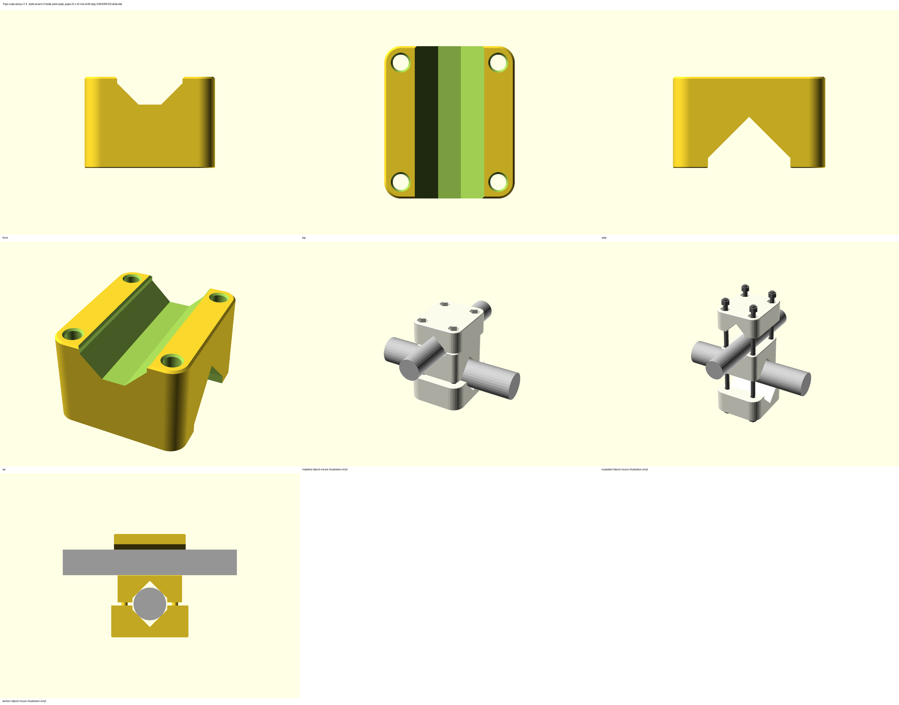

# DATASHEET — Pipe cross clamp, fixed angle — 3D printed product technical specification

## General Information
| Field | Value |
|---|---|
| Internal Ref. | N/A — request number to be assigned |
| Name | Pipe cross clamp, fixed angle (`pipe_cross_clamp`) |
| Product stage | Product in development — v1.4, fits **not confirmed** (coupon, gauge and first article pending) |

## FORM
### Product picture

Short visual guide: `README.md`. This DATASHEET is the full record.

### Version / Category / Subcategory / Critical item / Dangerous goods / Short description
- Version: 1.3 (2026-09-26) — all-parts print plate option; part geometry identical to 1.0
- Category: Logistics
- Subcategory: General mounting / workshop
- Critical item: No — non-clinical, ≤ 2 kg positioning load. It becomes critical (§4.2) as soon as it is used in a patient area, above a patient or carrying a device.
- Dangerous goods: No
- Short description: A parametric clamp that joins two pipes of different outside diameters crossing at a fixed angle (0–90°, set in the Customizer). Each pipe sits in a self-centring 90° V-seat. Two closing methods come from the same file:
  - **bolts**: body + 2 caps, clamped by two M6 through-bolts.
  - **zip ties**: a single-piece body with 4 zip ties running through channels inside it.

### Dimensions / Use / Solution type
- Overall dimensions, defaults Ø32 × Ø25 at 90°:
  - Bolts variant: body 53.8 × 62.9 × 37.6 mm; cap 1 66.4 × 75.5 × 31.1 mm; cap 2 69.9 × 60.8 × 26.2 mm.
  - Zip-tie variant: body 48.0 × 54.2 × 61.5 mm.
  - Every combination in the Customizer range (pipes Ø10–60 mm, 0–90°) stays within 200 mm; the console prints the size.
- Single/Multiple use: multiple use (bolts variant can be removed and refitted; zip ties are cut and replaced)
- Permanent/Temporary solution: either; re-check monthly when installed

### Intended use and out-of-scope uses (UMS)
- **Intended situations of use:**
  - Joining two pipes, poles or rods crossing at a fixed angle, e.g. frames, racks, stands, tent or shelter fittings, training set-ups and workshop jigs.
  - Non-clinical areas only; positioning loads up to 2 kg, kept close to the clamp.
- **Explicitly not intended for:**
  - Use in a patient area, above a patient, or as part of patient support.
  - Carrying a medical device, or carrying the weight of a person.
  - Anything that can fall on someone if it slips.
  - Loads above 2 kg.
  - Structural bracing of tents or shelters in wind.
  - Outdoor use in PLA.
  - Use above 50 °C.
  - Contact with unpackaged food, drink or medicine.
  - Autoclaving.

### Readiness
The levels come from the Humanitarian Making scale, quoted verbatim with the MSF interpretation (`references/readiness-levels.md`). **That file is not in the installed skill package**, so no level is written here yet. The evidence for each field is ready; the level will be set from the scale and stays "proposed" until the 3D printing advisor confirms it.

| Readiness | Level (proposed) | Evidence |
|---|---|---|
| Field readiness | pending scale file | Needs two M6 bolts (or threaded rod) or four zip ties; one print session. |
| Maker readiness | pending scale file | Single material, no supports, no brim, every STL in print position; default slicer profile is enough. |
| User readiness | pending scale file | Fitting is simple, but the bolts must not be over-tightened; the gauge check needs calipers. |
| Technology readiness | pending scale file | Designed and verified by software only; not yet printed or load-tested. |
| Risk level | pending scale file | Non-clinical; ≤ 2 kg; the failure is a slip or drop of a light load. |

### Justification of using 3D printed item
Cross-clamps for two *different* pipe diameters at a chosen angle are rarely available locally. Scaffold couplers only fit one tube size and are heavy. Printing one clamp per diameter pair and angle, from a measured pipe, solves this in a few hours with kit filament and common hardware.

### Approval required by
- Design: MSF 3D Printing Advisor.
- Each deployment: line manager of the area. If ever used in a clinical area, a new scope check is needed, plus approval by the Biomed advisor and IPC advisor.

## FIT
### Compatibility
#### Primary compatibility
Any two round pipes, tubes or rods with outside diameters Ø10–60 mm, crossing at 0–90°. For a crossing at 120°, use the 60° clamp (180° − θ is the same clamp). Each clamp is printed for one measured diameter pair and one angle.

Accepted range per seat (bolts variant):

| Seat | Smallest pipe | Largest pipe | Why |
|---|---|---|---|
| Pipe 1 | set diameter − 2.1 mm | set diameter + 1.4 mm | below: the cap touches the body before it clamps; above: the pipe no longer fits the seat mouth |
| Pipe 2 | set diameter − 2.1 mm | set diameter + 1.4 mm | same |

The zip-tie variant accepts about −3 / +1.4 mm. Outside these ranges, measure the pipe, change the parameter and reprint. The defaults Ø32 / Ø25 are **UNVERIFIED** placeholders; measure your pipes first.

#### Compatible accessories
- Bolts variant:
  - 4 × M6 bolts (hex head or socket head), 4 × M6 nuts, 4 × M6 washers Ø12 (under the bolt heads). **Minimum bolt length 69 mm at the defaults: use M6 × 70 or M6 × 75.** The OpenSCAD console prints the minimum for every size. The nuts sit captive in hex wells in cap 2 — only one tool is needed.
  - M6 threaded rod cut to length also works: per bolt, one nut captive in cap 2 and one nut + washer in the cap 1 counterbore.
  - M5 (kit hardware) or M8 is selectable in the bolt size list; washer and nut sizes follow automatically (ISO 7089 / ISO 4032).
- Zip-tie variant: 4 zip ties, 6.0 mm wide × 1.6 mm thick (UNVERIFIED — change `tie_w`, `tie_t` to yours), long enough to go round the pipe plus about 60 mm.

### Tolerance to misalignment
The mating part here is the pipe, which varies in diameter and roundness. Envelope for the bolts variant at the default settings. The nominal row was checked on a section of the exported STL; the other rows are calculated:

| Case | Pipe diameter vs set value | Result |
|---|---|---|
| Undersize limit | −2.1 mm | cap touches body — no clamping: reprint smaller |
| Nominal | 0 | pipe touches all 4 V faces; cap-to-body gap 3.0 mm (checked on the exported STL: the pipe is tangent to the V at 16.0 mm from its axis) |
| Oversize | +1.4 mm | fills the seat mouth (0.3 mm left per side); gap 5.0 mm |
| Oval pipe | ±0.5 mm | self-centring V takes it up; no action |

### Parameters (Customizer)
In the Customizer, choices are **lists**: part, closure and bolt size (M5 / M6 / M8). The part list includes **All clamp parts – one print plate** (bolts: body + 2 caps; zip ties: body) and **All clamp parts + 2 gauges – one print plate**. The parts are laid out in rows on the 250 × 210 mm MK4S bed with a 5 mm edge margin and a gap set by `plate_gap`; if they do not fit, the Customizer says so and asks you to choose the parts one by one. Numbers are **sliders** limited to the tested ranges, and the pipe preview is a checkbox. Nothing needs to be typed. The label above each widget explains the setting.

| Parameter | Default | Range | What it changes | Confirmed by test print |
|---|---|---|---|---|
| `part` | body | list: Body, Cap 1, Cap 2, Seat gauge, All clamp parts (one plate), All clamp parts + 2 gauges (one plate) | which part(s) to export (caps: bolts variant only) | — |
| `closure` | bolts | bolts, zipties | closing method | — |
| `pipe1_d` | 32 **UNVERIFIED** | 10–60 mm | pipe 1 outside diameter (bottom seat) | not yet |
| `pipe2_d` | 25 **UNVERIFIED** | 10–60 mm | pipe 2 outside diameter (top seat) | not yet |
| `angle` | 90 | 0–90° | crossing angle | not yet |
| `seat_len1`, `seat_len2` | 30 | 20–80 mm | seat length along each pipe. For the bolts variant this is a minimum: the body grows so the bolt bosses never stick out past a seat end | not yet |
| `v_angle` | 90 | 60–90° | V-seat included angle | not yet |
| `seat_clear` | 1.0 | 0.5–3 mm | clearance per side at the seat mouth | not yet |
| `clamp_gap` | 3.0 | 1–5 mm | cap-to-body gap at the nominal diameter (bolts close it) | not yet |
| `floor_relief` | 0.5 | 0.2–2 mm | gap under pipe 2 above the flat floor of the top seat | not yet |
| `bolt_clear` | 0.6 | 0.2–1.2 mm | extra on the bolt hole **diameter**, total (coupon row 2) | not yet |
| `tie_w`, `tie_t` | 6.0, 1.6 **UNVERIFIED** | 2.5–9, 0.8–2.5 mm | zip-tie width and thickness | not yet |
| `tie_clear` | 0.5 | 0.3–1.0 mm | clearance per side in the tie channels (coupon row 1) | not yet |
| `bolt_d` | 6 (M6) | list: M5, M6, M8 | bolt size | — |
| `bolt_tool_d` | 18 | 14–26 mm | counterbore in cap 1 for the bolt head, washer and a socket spanner | — |
| `web` | 5 | 3–10 mm | minimum solid material between the seats (bolts variant; the 45° transition may make it larger) | — |
| `seat_wall` | 3.0 | 1.8–6 mm | wall beside each seat mouth | — |
| `floor_t`, `cap_back` | 8, 10 | 6–12, 6–20 mm | solid cap floor under the bolt head / captive nut; cap material above the V apex (carries the clamping load across the pipe) | — |
| `channel_wall`, `tie_bend_r` | 1.8, 6 | 1.8–3.6, 5.5–10 mm | wall around the tie channels; minimum bend radius of the channels (grows automatically for wide ties) | — |
| `plate_gap` | 8 | 3–20 mm | gap between parts on the all-parts print plate | — |
| `corner_r` | 4 | 2–8 mm | maximum vertical edge radius of the body blocks; reduced automatically where it would thin the wall at a seat end or beside a tie slot (console shows the radii used) | — |

### Manufacturing Instructions
#### 3D printing optimization
Pre-engineered: every STL is in its print position on Z = 0. Print as provided: **no supports, do not rotate**. One-plate files: `plate_bolts` (body + 2 caps, 206 × 75.5 mm), `plate_bolts_gauges` (+ 2 gauges, 206 × 126 mm), `plate_zipties_gauges` (body + 2 gauges, 204 × 54 mm). Identical items are delivered as numbered files: `gauge_1`, `gauge_2`.
- **Body:** printed on its pipe-1 face. The pipe-1 seat opens downwards with a pointed 45° roof; the pipe-2 seat opens upwards with a flat floor. A 45° transition joins the two blocks.
- **Caps:** printed face down, with the seat opening downwards (pointed roof).
- **Holes and slots:** all bolt holes and zip-tie slots are vertical. The horizontal runs of the tie channels have 45° gabled roofs.
- **Edges:** bottom edges are chamfered 0.4 mm and top edges 0.8 mm.

#### Material and color
The shelf is not confirmed yet, so the part is designed to hold its load in PLA at the default slicer profile.
1. **PETG — preferred.** Tougher, creeps less under bolt preload, suitable for outdoor use.
2. **PLA — acceptable** indoors below 40 °C. Re-tighten the bolts after one week.
3. **ASA or PC Blend** only for outdoor use or above 50 °C, via the 3D printing advisor.

TPU is not suitable (too soft to hold the angle). Print all parts of one clamp in the same material. Any colour for non-clinical use; white, natural or a light colour if it is ever moved to a clinical area.

#### List of other materials
- Bolts variant:
  - 4 × M6 bolts (≥ M6 × 70 at the defaults), or M6 threaded rod.
  - 4 × M6 nuts (plain; held captive in cap 2).
  - 4 × M6 washers Ø12 (bolt-head side).
- Zip-tie variant: 4 zip ties 6 × 1.6 mm (or as set in `tie_w`, `tie_t`).

#### 3D Printer
- Any FDM 3D printer; reference: Original Prusa MK4S, 0.4 mm nozzle, PrusaSlicer 2.9.x.

#### Slicer settings
- Works with the printer's default profile (2 perimeters, 15 % infill).
- Recommended for a longer life: 0.2 mm layers, 4 perimeters, 40–60 % infill. No supports, no brim; print sheet for the material, no glue.
- Estimated filament at the default profile (not sliced — confirm in PrusaSlicer):

| Part | PETG |
|---|---|
| Body (bolts variant) | ≈ 37 g |
| Cap 1 | ≈ 11 g |
| Cap 2 | ≈ 9 g |
| Body (zip-tie variant) | ≈ 30 g |
| Gauge | ≈ 6 g |

- Estimated print time: about 2–3 h for a complete bolt-variant clamp on the MK4S (well under 48 h).

#### Post processing instructions
- Remove stringing, especially inside the tie channels (push a zip tie through each channel once).
- Deburr the seat mouths and bolt holes with the kit deburring tool.

#### Assembly instructions
**First, check the fit (before printing the clamp):**
1. **Measure** both pipes with calipers: two readings at 90° to each other on each pipe; use the larger. Enter them as `pipe1_d` and `pipe2_d`, then set `angle`.
2. **Print the coupon** and reply with its code (for example "3B"). Set `tie_clear` from the number (1 = 0.3, 2 = 0.5, 3 = 0.7, 4 = 0.9) and `bolt_clear` from the letter (A = 0.2, B = 0.4, C = 0.6, D = 0.8).
3. **Print two gauges** and hold one on each side of pipe 1, with the pipe in the notch marked with its diameter.
   - The gap between the two plates should be about 3 mm.
   - 0 mm: the pipe is too small for the seat. Over 5 mm, or the pipe will not enter: too large. Either way, change the diameter and reprint.
   - Repeat with the pipe-2 notches.

**Bolts variant:**
4. Put the body on pipe 1 (pipe 1 in the bottom seat), with cap 1 under it.
5. Put pipe 2 in the top seat and cap 2 over it.
6. Drop a nut into each of the 4 hex wells of cap 2. Push the 4 bolts, with a washer under each head, up through the cap 1 counterbores, the body and cap 2 into the nuts.
7. Tighten the 4 bolts evenly, crosswise (like wheel nuts), with a 10 mm socket or a hex key through the counterbores, until the clamp no longer turns on either pipe by hand, then at most a ¼ turn more. **Do not over-tighten** — the plastic creeps and the pipe can deform. The caps must not touch the body; if they do, the pipe is too small (step 3).

**Zip-tie variant:**
8. Put the body on pipe 1. Push a tie up one pipe-1 slot on the underside; it follows the channel and comes out of the opposite slot.
9. Take the tie round pipe 1, close it and pull it tight with pliers. Do the same with the second pipe-1 tie.
10. Place pipe 2 in the top seat and fit its two ties the same way, from the top face.

**Installation position:** mount so that a slip cannot drop anything onto a person or equipment. Keep the load close to the clamp — the rotation resistance is limited (see Additional notes). Clean before use.

#### QC procedures
- **Visual inspection:** complete print, no layer separation, no whitened areas, channels open (a tie passes through freely).
- **Dimensional validation:** calipers on the seat mouth width (set diameter + 2 × `seat_clear` ± 0.3 mm) and on the bolt holes (bolt + `bolt_clear` ± 0.2 mm).
- **Tolerance inspection:** the gauge test of assembly step 3; the pipe seats in the V without rocking.
- **Safety validation:** by the line manager of the area before use.
- **Test before use** (performed by the person installing it; the line manager signs):
  1. Function: fit, tighten, remove and refit 3 times. The clamp holds the angle and the caps never touch the body.
  2. Fit: no rattle; the pipe does not turn by hand after tightening.
  3. Load: hang 4 kg (2 × the design load) at the point where the real load will hang, for 10 min. **Pass:** slip under 2 mm along or around the pipe, no cracks, no whitening, hardware in place.
  4. Cleaning: wipe once with the site agent; no softening or whitening.
  5. Edges: nothing sharp to the touch.
  6. Test to failure: not required (non-critical, low load); required before any batch of 10 or more.
- **Follow-up schedule after installation** — *proposed; to be validated by the 3D printing advisor.* The installer, or the user named at installation, checks and records the date, the result and any action in the site's 3D printing log. A cracked, whitened or slipping clamp is removed at once.

| When | What to check | Action |
|---|---|---|
| 2 weeks | Bolt tightness (PLA creeps: re-tighten evenly, max ¼ turn); slip marks on the pipes; cracks or whitening around the cap counterbores / nut wells and at the seat mouths; zip ties intact | re-tighten; replace ties; remove if damaged |
| 1 month | As at 2 weeks, plus the effect of cleaning (softening, surface whitening) | as above |
| 3 months | As at 1 month; decide with the line manager whether the clamp stays, is replaced by a stock part or moves to PETG / ASA | record the decision |
| Every 3 months after | As at 3 months, while installed | as above |

## FUNCTION
### Detailed description of the component/product/workflow and its use
The body carries a V-seat for pipe 1 on its underside and a V-seat for pipe 2 on top, turned by the crossing angle. The two seats are separated by a solid web and a 45° transition.
- **Bolts variant:** the pipes are clamped between the body and two caps, and four through-bolts pull all three parts together — **two on each side of each pipe**, never on one line, so the caps cannot rock. The bolt layout follows the angle: one bolt in each quadrant around the crossing (a rectangle at 90°) for large angles, or two pairs spread along the pipes for small angles, whichever is more compact; the console names the layout. Each cap is **one solid convex block** covering its seat and all four bolt bosses — no wings and no inside corners — so the bolt load travels through the block in compression and in bending along the layers, never pulling layers apart. Cap 1 has counterbores for the bolt heads (socket access); cap 2 holds the nuts captive in hex wells; both keep an 8 mm solid floor under the head / nut so the bolts stay short. The bolt positions are computed for every angle: as close to the crossing as the clearance around both seats allows (≥ 2.5 mm between each counterbore / nut well and its seat), one bolt on each side of each pipe.
- **Zip-tie variant:** each pipe is held by two ties that run through U-shaped channels inside the body (up a slot, over the seat, down the other slot). The two pipes' channels sit at different heights so they never collide at any angle.
- **Gauge:** a 4 mm plate with both seat profiles, used to check the pipe diameter before printing the clamp.

### Additional notes
- **Unverified values:** `pipe1_d` = 32, `pipe2_d` = 25, `tie_w` = 6.0, `tie_t` = 1.6. These are placeholders; measure before printing.
- **Clearance directions:**
  - `seat_clear`: per side, at the seat mouth.
  - `bolt_clear`: total, on the hole diameter (includes the +0.2 mm vertical-hole compensation).
  - `tie_clear`: per side, on both width and thickness of the channel.
  - `clamp_gap`: total, between each cap and the body at the nominal diameter.
- **Deviations from the MSF design rules:** vertical edge radius at the body block corners is below 4 mm where a larger radius would thin a wall below 1.8 mm ("where the footprint allows"): 0.5–1.2 mm at the seat ends of the bolts variant; 4 mm (lower) and 1.75 mm (upper block, beside the pipe-2 tie slots) in the zip-tie variant. A 4 mm radius everywhere would leave 0.25 mm walls at the seat ends and about 0.9 mm beside the upper tie slots.
- **Hand estimate (bolts variant, PLA, default sizes):**
  - Clamping: a hand-tightened M6 gives about 300 N per bolt; 4 bolts give 1 200 N, which the 90° V-seats multiply to about 3 400 N of normal force on the four faces of each pipe.
  - Slip along a pipe: resistance ≈ 0.3 × 3 400 ≈ 1 000 N, against 20 N for 2 kg.
  - Turning around pipe 2 (the smaller): resistance ≈ 1 000 N × 12.5 mm ≈ 12 N·m, so 2 kg is held up to a lever of about 0.6 m. Keep loads within 0.4 m of the clamp.
  - Cap bending across the pipe (600 N per side): the V wedge pushes each half of the cap outwards; 10 mm of material over the V apex along ≈ 66 mm of seat → about 9 MPa. The v1.0–1.3 cap (4 mm over the apex) reached about 50 MPa.
  - Layers: horizontal shear in the cap ≈ 0.6 MPa; counterbore floor (8 mm) punching shear ≈ 1 MPa at 300 N, 3 MPa if over-tightened to 1 000 N. No load path pulls layers apart: there are no wings, and every inside corner is gone.
  - Wobble: 4 bolts at non-collinear points, 2 per side of each pipe; the resultant of the bolt forces passes through the crossing.
- **Hand estimate (zip-tie variant):** hand-pulled ties give roughly a third of the grip of the bolts variant. Keep loads within 0.1 m of the clamp, and rely on the 4 kg test.
- **Known limits:** no load rating published beyond the 2 kg design load; not tested physically yet.

### Cleaning and disinfection / sterilization procedures
- Agents: Surfanios, bleach 1:10, or IPA; follow IPC guidelines.
- Do not autoclave.

### Packaging and storing instructions
- Store the parts of one clamp together with the hardware in a sealable zip-lock bag, labelled with the diameters and angle; room temperature; no direct sunlight or humidity.

### Related links, standards, safety considerations
- Warnings:
  - Not a patient-support device; do not use in patient areas without a new approval.
  - Do not autoclave.
  - Do not over-tighten.
  - Replace cracked or whitened parts.
  - Falling-object hazard: mount only where a slip cannot hurt anyone.
- No text on the clamp parts. The gauge (a test piece) carries debossed diameters.

### Spaulding Classification (IPC)
- No patient contact — non-clinical item; to be confirmed by the IPC advisor if the use changes.

### Risk assessment (UMS - critical items)
Not a critical item; the short assessment is given for the approver.

| # | Hazard / failure point | Foreseeable harm | Likelihood | Severity | Mitigation (designed-in / procedural) |
|---|---|---|---|---|---|
| R1 | Pipe turns or slides in the clamp | attached pipe or light load (≤ 2 kg) swings or drops | Low | Low–Medium | V-seats, 4 kg test before use, loads kept close to the clamp, no use above people |
| R2 | Cap cracks from over-tightening | loss of clamping | Low | Low | solid caps (no wings), 10 mm over the apex, 8 mm floors, ¼-turn rule, PETG preferred |
| R3 | Pipe outside the accepted range | no clamping | Medium | Low | gauge check before printing; accepted range in the console and README |
| R4 | PLA creeps or softens (heat, sun) | slow loosening | Medium (outdoor) | Low | PETG / ASA outdoors; monthly check; re-tighten after one week |

## VERIFICATION (§10) — v1.3, 2026-09-26, OpenSCAD 2021.01 + manifold3d 3.5.4, tools/check_stl.py
| # | Test | Result | Evidence | Pass |
|---|---|---|---|---|
| T1 | Render at defaults, every variant | 5 variants + coupon: exit 0, no warnings. v1.3 single-part meshes are identical to v1.2, v1.1 and v1.0; the one-file Customizer gives the identical plate; every part on every plate is Manifold-valid; the one-file Customizer version gives identical meshes for all 5 variants; a Customizer parameter set (Cap 2, M8, 45°, Ø40.5) loads through OpenSCAD's Customizer parser in both files | stl/EXPORT_LOG.txt | pass |
| T2 | Parameter sweep | v1.4 (after the cap / bolt redesign): 154 cases — body, cap 1, cap 2 at every 10° from 0° to 90°, Ø10/60 pairs at 0/45/90°, min and max of every cap / bolt parameter, M5 and M8, all-parts plates — 151 PASS, 3 GUARD (Ø60 × Ø60 plates do not fit the bed), 0 FAIL; `tools/sweep_report_v1.4_2026-09-26.txt`. v1.3: all-parts plates, both closures, Ø10/32/60 pairs at 0° and 90°, plate_gap 3 and 20 — 33 PASS, 1 GUARD (Ø60 × Ø60 at 90° with gauges does not fit the bed — refused with its message); report `tools/sweep_report_plates_v1.3_2026-09-26.txt`. v1.2: every option of the three lists (4 parts × M5 / M6 / M8, both closures) — 14 PASS, 2 GUARD (caps with zip ties, as designed). Earlier: 350 cases (min / max of every parameter for body-bolts, body-zip ties, cap 1, cap 2, gauge; plus Ø10/60 pairs × 0°, 15°, 45°, 90°): 350 PASS, 0 FAIL | tools/sweep_report_*_2026-09-26.txt | pass |
| T3 | Guards | angle 100°, v_angle 100°, caps with zip ties, counterbore too small for the washer, ties on a Ø6 pipe, seat_len 200, zip seat too short: each refused with its message | this table | pass |
| T4 | Manifold / watertight | every STL watertight, one body, positive volume; independently accepted by the Manifold library (manifold3d 3.5.4: status NoError, volume matches, genus = designed openings) | stl/*.check.json | pass |
| T5 | Bounding box | plates 206.1 × 75.5, 206.1 × 125.8, 204 × 54.2 mm (inside the 240 × 200 mm usable bed); parts ≥ 8 mm apart; body-bolts 53.8 × 62.9 × 37.6; cap 1 66.4 × 75.5 × 31.1; cap 2 69.9 × 60.8 × 26.2; body-zip 48.0 × 54.2 × 61.5; gauge 70 × 42.3 × 4; coupon 59.2 × 47.6 × 4 mm; all ≤ 200 over the whole range | check.json, sweep | pass |
| T6 | Print position | min Z = 0 on every STL; bed contact 28 % (body-bolts, two rails beside seat 1), 16 % (body-zip), 73 % (gauge). No brim or ears needed: smallest contact 371 mm² on the zip-tie body, height ≈ 1.1 × its width | check.json | pass |
| T7 | Overhang scan (min-area 0.5 and 0.02) | worst 45.0°, 0 facets over the limit, every STL and every sweep case | check.json | pass |
| T8 | Bridges | none (tie channels have 45° gabled roofs) | check.json | pass |
| T9 | Minimum features | thinnest wall 2.25 mm (body-bolts, at the top face), 2.55 mm (caps, inside), 1.85 mm (body-zip, around tie slots); web 5.0 mm; caps: ≥ 3 mm around every counterbore and nut well up to the top face, 8 mm floors, 10 mm over the V apex | check.json sections | pass |
| T10 | Hole compensation | all holes vertical; `bolt_clear` includes the +0.2 mm compensation; 45° chamfer at the bed, lead-in at the top | .scad | pass |
| T11 | Ghosts / scenes excluded | pipes are `%` ghosts; scenes only in pipe_cross_clamp_context.scad (assert $preview) | .scad, STLs | pass |
| T12 | Colour bands | N/A | — | n.a. |
| T13 | Text fits | gauge labels (size 6) inside the 18 mm margins over the range | sweep (gauge) | pass |
| T14 | Render set | front, top, side, iso, installed, exploded, section for both bodies; views for caps, gauge, coupon; min / max / 30° | img/ | pass |
| T15 | Slicer dry run | not run (PrusaSlicer not available in the sandbox); filament and time are estimates | — | not done |
| T16 | Documentation and data | header, README, STATUS complete; no personal data | files | pass |
| T17 | Pre-export checklist | walked; deviations recorded (corner radii) | STATUS.md | pass |
| T18 | Interface identity | N/A (no copied interface) | — | n.a. |
| T19 | Section check | sections through seats, transition and tie channels; walls ≥ 1.85 mm; "2 pieces" below the web is expected | check.json | pass |
| T20 | Seat vs pipe (envelope) | section of the exported body: both nominal pipes tangent to all V faces (16.0 / 12.5 mm from axis), 0.5 mm under pipe 2; gauge notch within 0.05 mm of the model | Tolerance table above | pass |
| T21 | Overlay | N/A (no photo or sketch source) | — | n.a. |

**Not verified:** physical print, coupon, fit on real pipes, 4 kg load test, cleaning test, slicer time and filament.

**Export engine:** the rules ask for `openscad-fast` (Manifold). It is not available in this sandbox (no OpenSCAD snapshot is reachable), so the STLs were exported with OpenSCAD 2021.01 (CGAL) and then validated with the Manifold library. Re-exporting with `openscad-fast` on the advisor's machine should give the same meshes; compare with the volumes in stl/*.check.json.

## ATTACHMENTS
- **Parametric source:**
  - `pipe_cross_clamp.scad` (Customizer-ready, uses `common.scad` + `helpers.scad`)
  - `pipe_cross_clamp_customizer.scad` — **one-file Customizer version** for online Customizers (Printables, MakerWorld, Thingiverse); generated by `tools/make_customizer.py`, same geometry
  - `pipe_cross_clamp_context.scad` (renders only)
  - `pipe_cross_clamp_coupon.scad`
  - `common.scad`, `helpers.scad`
- **STL files** in `stl/` (see `stl/EXPORT_LOG.txt` for the exact parameter sets):
  - `pipe_cross_clamp_body_bolts_v1.4.stl`
  - `pipe_cross_clamp_cap1_v1.4.stl`
  - `pipe_cross_clamp_cap2_v1.4.stl`
  - `pipe_cross_clamp_body_zipties_v1.4.stl`
  - `pipe_cross_clamp_gauge_v1.4.stl`
  - `pipe_cross_clamp_coupon_v1.4.stl`
- **Renders:** `img/`.
- **Brief and plan:** `brief/`.
- **Checks:** `tools/` (scripts, `combo_cases.json`, `sweep_report_*_2026-09-26.txt`); `stl/*.check.json`.
- No personal data in any file.
- Made with the msf-3dp-design skill package v1.2.0 and the updated MSF project instructions (26 Sep 2026); OpenSCAD 2021.01 (CGAL), validated with manifold3d 3.5.4; checks: tools/check_stl.py, tools/sweep_report_*.txt.

| Role | Name | Date |
|---|---|---|
| Designed by | MSF 3D Printing for All (Claude, msf-3dp-design skill) for the MSF 3D Printing Advisor | 2026-09-26 |
| Product approved by | | |
| Product tested by | | |

## VERSION HISTORY
| Version | Date modified | Modified by | Changes |
|---|---|---|---|
| 1.0 | 2026-09-26 | MSF 3D Printing for All | Initial design and documentation; fits not confirmed |
| 1.1 | 2026-09-26 | MSF 3D Printing for All | Updated to the new project rules: one-file Customizer version; short visual README + this DATASHEET; licence statements removed; readiness fields set up for the Humanitarian Making scale (levels pending the scale file); follow-up schedule after installation; Manifold validation of all STLs. Geometry unchanged (meshes identical to 1.0) |
| 1.2 | 2026-09-26 | MSF 3D Printing for All | Customizer: part, closure and bolt size are lists, numbers are sliders, descriptions shown as labels (trailing text had turned every widget into a text box); context scene section plane as checkbox + slider. Geometry unchanged (meshes identical to 1.1) |
| 1.3 | 2026-09-26 | MSF 3D Printing for All | Part list: "All clamp parts – one print plate" and "All clamp parts + 2 gauges – one print plate" (automatic row layout on the MK4S bed, `plate_gap` slider, guard when the parts do not fit); gauges delivered as numbered files gauge_1 / gauge_2; plate STLs added. Part geometry unchanged (meshes identical to 1.2) |
| 1.4 | 2026-09-26 | MSF 3D Printing for All | After requester review: 4 through-bolts (2 per side of each pipe, "corners" or "pairs" layout by angle) instead of 2 diagonal ones (wobble); solid convex caps without wings (no layer-peeling root), 10 mm over the V apex, counterbores in cap 1, captive-nut hex wells in cap 2, full bolt wall to the top face; washer / nut sizes from the bolt size. Zip-tie body, gauges and coupon unchanged (meshes identical to 1.3) |
