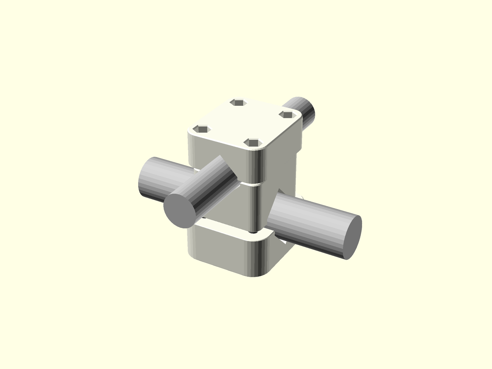
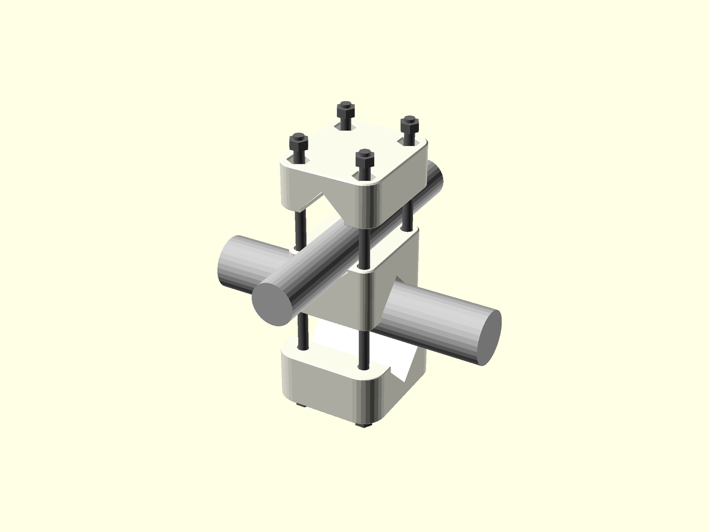
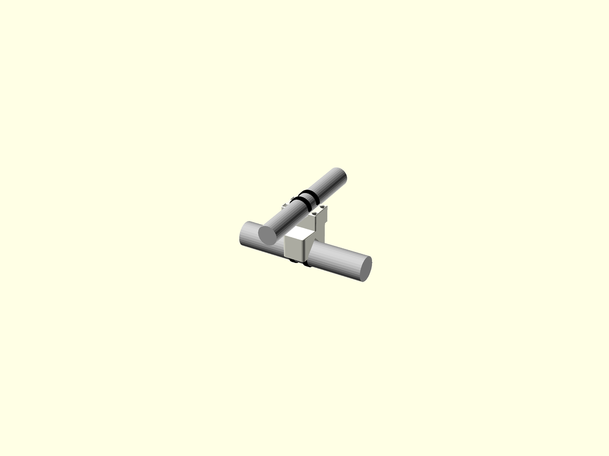
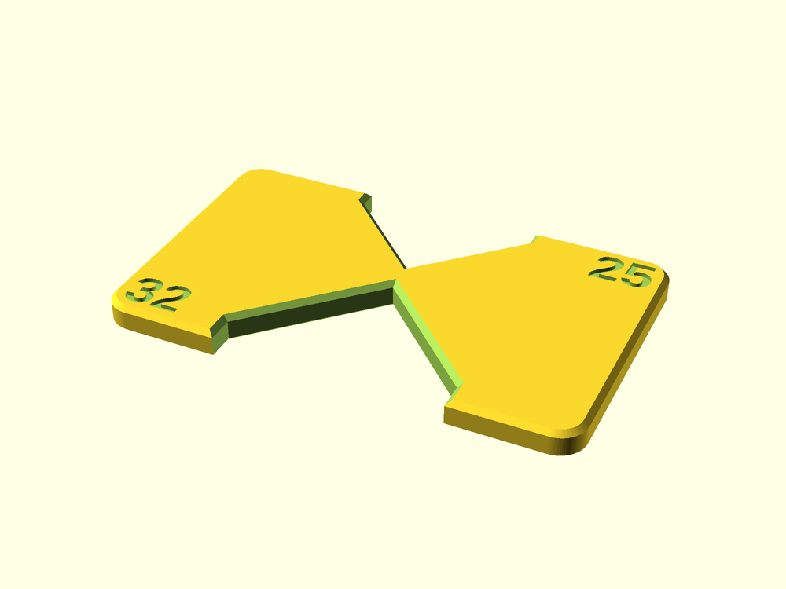
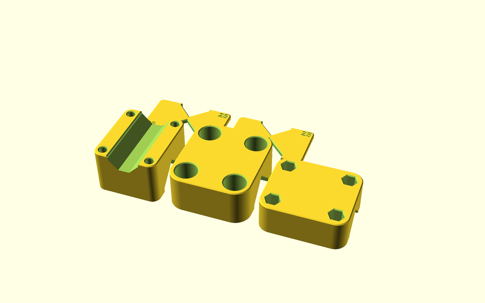
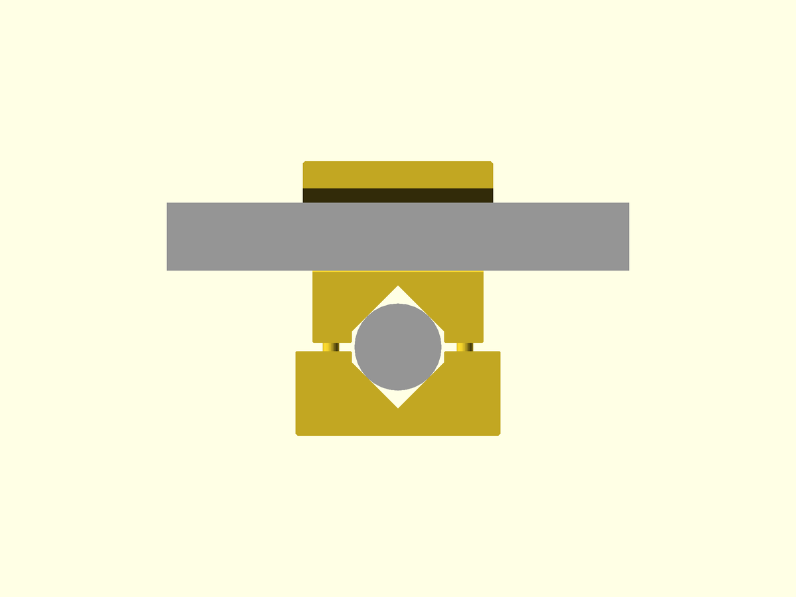

# Pipe cross clamp, fixed angle — v1.4

Joins two pipes of **different sizes** that cross at a **fixed angle** (0–90°). It fits onto pipes that are already in place. For **non-clinical use only**, with loads up to 2 kg. Full details are in [DATASHEET.md](DATASHEET.md).

**Status:** not yet printed or tested. Every fit is **not confirmed**.

## Two versions — pick one
| Bolts (strongest, removable) | Zip ties (one printed part) |
|---|---|
|  |  |
| Print: body + cap 1 + cap 2 | Print: body only |
| Hardware: 4 × M6 bolts **70 or 75 mm** long, 4 nuts, 4 washers — one 10 mm socket or hex key | Hardware: 4 zip ties, 6 mm wide |
| Keep the load within 0.4 m of the clamp | Keep the load within 0.1 m of the clamp |

## Before you print: make it fit your pipes
1. **Measure** both pipes with calipers across the outside, twice on each pipe (turn 90° between readings). Use the larger number.
2. Open `pipe_cross_clamp.scad` in OpenSCAD (Window → Customizer), or `pipe_cross_clamp_customizer.scad` in an online Customizer. Pick the part, the closure and the bolt size from the lists, and set the pipe diameters and the angle with the sliders. The defaults (32 and 25 mm) are only examples.
3. **Print the coupon** (≈ 20 min) and **two gauges**.
   - Coupon: find the tie slot (1–4) and bolt hole (A–D) that fit best, and reply with the code, e.g. "3B".
   - Gauges: hold one on each side of a pipe. The gap between them should be about **3 mm**.

## Print
**All parts at once:** choose *All clamp parts – one print plate* in the part list, or use a ready plate file.

- **PETG** is preferred; PLA is fine indoors, away from heat.
- Use the STLs as they are, with **no supports and no brim**. Do not rotate them.
- The default printer profile is enough.

## Fit it
1. Put pipe 1 in the bottom seat and pipe 2 in the top seat.
2. **Bolts:** drop a nut into each of the 4 hex wells of cap 2 (they stay there). Put a washer under each bolt head, push the 4 bolts up through the cap 1 counterbores, the body and cap 2 into the nuts. Tighten them evenly, crosswise like wheel nuts, until the clamp no longer turns by hand, then at most **¼ turn** more. The caps must not touch the body.
3. **Zip ties:** push each tie into its slot; it comes out of the opposite slot. Take it round the pipe and pull it tight.
4. **Test before use:** hang 4 kg for 10 minutes where the real load will hang. It passes if it slips less than 2 mm and shows no cracks.

## Warnings
- Not for patient areas, not above people, not for loads over 2 kg.
- Do not over-tighten. Do not autoclave.
- Replace it if it is cracked, whitened or slipping.

## Check it after installation
Check at **2 weeks, 1 month and 3 months**, then every 3 months. Look at bolt tightness, slip marks, cracks and ties, and record each check in the site's 3D printing log. This schedule is proposed and must be validated by the 3D printing advisor.

## Files
| File | What it is |
|---|---|
| `stl/…body_bolts_v1.4.stl`, `…cap1…`, `…cap2…` | bolts version (3 parts) |
| `stl/…body_zipties_v1.4.stl` | zip-tie version |
| `stl/…plate_bolts_v1.4.stl` | bolts version, all 3 parts on one plate |
| `stl/…plate_bolts_gauges_v1.4.stl`, `…plate_zipties_gauges…` | all clamp parts + 2 gauges on one plate |
| `stl/…gauge_1_v1.4.stl`, `…gauge_2…`, `…coupon_v1.4.stl` | fit checks — print these first |
| `pipe_cross_clamp.scad` / `pipe_cross_clamp_customizer.scad` | editable model / one-file version |
| `DATASHEET.md` | full technical record, tests, risks, approvals |
| `STATUS.md` | where the project stands |
